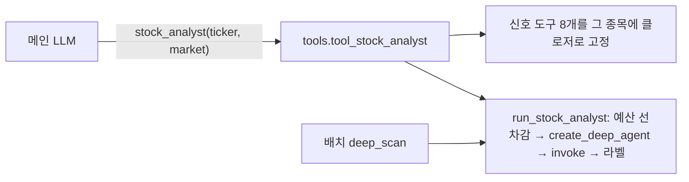
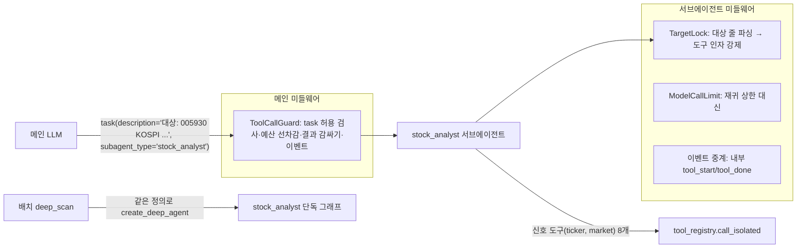

# stock_analyst를 메인 에이전트의 `subagents=`로 옮기는 설계

> 작성 2026-10-22. 상태: **2026-10-24 기본값 전환(`subagent`) + 관련기업·ETF 분석도 `subagents=`로 이전(§12).** 구현 결과는 §11, 실제 API 비교는 §11.5~11.6(1회). 사용자 결정: 메인 에이전트가 위임까지 관제하는 구조로 간다 — `stock_analyst`를 메인의
> `create_deep_agent(subagents=[...])`에 등록하고, 신호 도구는 그 서브에이전트가 갖는다.
> 관련: `subagent-wiring-rationale.md`(기존 agent-as-tool 구조를 택했던 이유 — 이 설계가 각 이유를 어떻게 메우는지 §3),
> `main-agent-migration-plan.md` §7(원래 "타입 인자 agent-as-tool 유지, 자유 질의형만 SubAgent" 권고).
> 근거 소스: 설치된 `deepagents 0.7.13`, `langchain 1.4`(줄 번호는 이 버전 기준).

---

## 1. 목표와 범위

**목표**
- 메인 에이전트가 사용자 질의를 보고 `stock_analyst`에 위임하고, `stock_analyst`가 필요한 신호를 골라 조사·종합한다 — 위임 결정이 메인
  그래프 안에서 보인다(관제).
- 지금 보장(종목 고정, 예산, 출처 라벨, 실패 격리, 배치 재사용, 노출 통제)은 **하나도 잃지 않는다**(§3).

**범위**
- 1차: `stock_analyst`만. 기능 플래그 뒤에서 기존 agent-as-tool과 공존(§4.4).
- 제외: `find_related_companies`, ETF 종합, 섹터 2차 탐색, `recommendation_synthesis` — 1차 결과(§8 평가)를 보고 결정. 특히 ETF 종합·섹터
  2차 탐색은 도구 내부의 한 단계라 옮길 대상인지부터 다시 판단한다(`subagent-wiring-rationale.md` §6).

---

## 2. 구조

### 2.1 지금 (agent-as-tool)


### 2.2 목표 (subagents=)


핵심 아이디어: 서브에이전트 정의(`stock_analyst_spec(context, on_event)`)를 **한 곳**에 두고, 메인의 `subagents=`와 배치의 단독
`create_deep_agent`가 같은 정의를 쓴다.

---

## 3. 기존 보장을 어떻게 지키나

| 보장 | 지금 | `subagents=`에서 그대로 두면 | 이 설계의 대책 |
|---|---|---|---|
| **종목 고정** | 신호 도구가 인자 없는 클로저(`tool_registry.py:364-375`) — 다른 종목 분석 불가 | 서브에이전트는 메인 그래프 생성 시 1회 컴파일(`subagents.py:826-830`) → 종목을 미리 못 묶음. 도구가 `ticker/market` 인자를 받아야 함 | **TargetLock 미들웨어**: 위임문 첫 줄 `대상: <ticker> <market>`(정해진 형식)을 `before_agent`에서 파싱(서브에이전트 첫 메시지 = 위임문, `subagents.py:762-763`), `wrap_tool_call`에서 인자가 대상과 다르면 실행하지 않고 오류 ToolMessage. 대상 줄이 없거나 market이 원자 시장이 아니면 메인 가드가 위임 자체를 거부 |
| **배치 재사용** | `deep_scan.py:52`가 `run_stock_analyst` 직접 호출 | `subagents=` 등록분은 메인의 `task`로만 실행 | `run_stock_analyst`를 같은 `stock_analyst_spec`으로 단독 `create_deep_agent`를 만들어 위임문(`대상: …`)을 넣고 invoke하도록 재구현 — **정의 1개, 실행 경로 2개** |
| **예산 선차감** | `stock_analyst.py:55` | `task`에 사전 훅 없음 | 메인 `ToolCallGuard`가 `task` 실행 **전에** `context.budget.try_consume_llm_calls(STOCK_ANALYST_LLM_CALL_ESTIMATE)` — 실패하면 서브에이전트를 띄우지 않고 `available=false` |
| **재귀 상한** | `invoke(config={"recursion_limit": 8})` | `task`는 서브에이전트에 설정을 따로 넘기지 않음(`subagents.py:791`) | 서브에이전트 미들웨어에 `ModelCallLimitMiddleware(run_limit=STOCK_ANALYST_RECURSION_LIMIT)` |
| **출처 라벨** | 코드가 `provenance` 부착(`stock_analyst.py:85`) | `task`는 결과(structured_response JSON 또는 마지막 텍스트)를 그대로 ToolMessage로(`subagents.py:689-715`) | 메인 `ToolCallGuard`가 `task` 결과를 받아 `{"available": true, "judgment": {...}, "provenance": "서브에이전트 자율 조사 결과"}`로 **다시 감싼다**(기존 도구 결과와 같은 모양 — 프롬프트·평가가 그대로 동작) |
| **실패 격리** | 모든 실패 → `available=false` | `task`는 invoke를 try 없이 호출(`subagents.py:793`) — 예외 전파 | 메인 `ToolCallGuard`가 `task` 실행을 try로 감싸 `available=false` ToolMessage로 변환 |
| **구조화 출력** | `response_format=StockAnalystResult` | `SubAgent.response_format` 지원(`subagents.py:163`) | 그대로 사용 |
| **노출 통제** | 레지스트리 16개만 보이게, `task` 숨김(`agent_middleware.py:60`) | `task`를 열어야 하고, general-purpose 서브에이전트가 자동 추가(`graph.py:795-796`) — GP는 우리 호출 상한 미들웨어를 상속하지 않음(`graph.py:822`) | `ExposureGuard` 허용 목록에 `task` 추가. `ToolCallGuard`가 `subagent_type`이 `stock_analyst`가 아니면 실행 거부(GP 포함). GP를 아예 끄는 방법은 하네스 프로필(`register_harness_profile`, 프로세스 전역·모델별)뿐이라 배치 서브에이전트에도 영향 — 스파이크 S2에서 결정 |
| **평가 캡처** | `tool_done`에 stock_analyst 결과 dict | 서브에이전트 내부 도구 호출은 메인 `on_event`에 안 보임 | 서브에이전트 이벤트 중계 미들웨어가 내부 `tool_start/tool_done`을 `{"subagent": "stock_analyst"}` 표시와 함께 같은 `on_event`로 낸다 — 답변 평가(녹화·재생, LLM 생성 문맥 분리)가 2단 근거를 볼 수 있게 됨 |

---

## 4. 구현 설계

### 4.1 파일
| 파일 | 변경 |
|---|---|
| `chat_agent/stock_analyst.py` | `stock_analyst_spec(context, on_event) -> SubAgent`(이름·설명·프롬프트·도구·`response_format`·미들웨어), `run_stock_analyst`를 이 spec 기반 단독 그래프 실행으로 재구현(시그니처 유지 — `deep_scan` 무수정) |
| `chat_agent/tool_registry.py` | `as_subagent_signal_tools(context, lock)` — `subagent_description`이 있는 8개를 `TickerMarketArgs` 스키마로(클로저 대신 인자), 실행은 `call_isolated`(예외 → `available=false`) |
| `chat_agent/agent_middleware.py` | `TargetLock`·`SubagentEventRelay`(서브에이전트용), `ToolCallGuard`에 `task` 처리(허용 subagent_type 검사·대상 줄 검사·예산 선차감·결과 감싸기·예외 변환) |
| `chat_agent/deep_loop.py` | 플래그가 `subagent`면 `create_deep_agent(subagents=[stock_analyst_spec(...)])`, 허용 목록에 `task` |
| `chat_agent/prompt.py` | 위임 규칙(§4.3) |
| `chat_agent/credentials.py` | `CHAT_AGENT_STOCK_ANALYST_MODE`(`tool` 기본 / `subagent`) |

### 4.2 위임문 형식
```
대상: 005930 KOSPI
요청: <사용자 질의 요지 — 무엇을 알고 싶은지>
```
- 메인은 반드시 `resolve_ticker`로 확정한 (ticker, market)만 대상으로 쓴다(기존 규칙과 동일).
- 한 위임에 한 종목. 관련기업 딥다이브처럼 여러 종목이면 위임을 여러 번(기존과 같은 횟수 상한).

### 4.3 메인 프롬프트의 역할 분리 (결정 필요 — §9 D1)
- **안 A(권장)**: 메인에서 신호 도구 8개를 빼고 "종목 분석은 `stock_analyst`에 위임"으로 단일화 — 관제가 가장 깔끔하고 중복 호출이 없다.
  단, "삼성전자 RSI만" 같은 단일 신호 질의도 위임을 거쳐 LLM 호출이 1~2회 늘 수 있다.
- **안 B**: 메인이 단일 신호는 직접, 종합 판단은 위임 — 비용은 덜 들지만 같은 일을 두 경로가 하게 돼 프롬프트 규칙이 복잡해진다.

### 4.4 기능 플래그와 공존
- `CHAT_AGENT_STOCK_ANALYST_MODE=tool`(기본): 지금과 동일.
- `subagent`: §2.2 구조. 레지스트리의 `stock_analyst` 도구는 메인에서 숨기고 `task`를 연다.
- 전환은 §8 평가 통과 후 기본값 변경. 2주 병행 후 `tool` 경로 제거(기존 D12 legacy 루프 제거와 같은 방식).

---

## 5. 먼저 확인할 것(스파이크) — 구현 전 가짜 모델로 검증

| # | 질문 | 방법 | 실패 시 |
|---|---|---|---|
| S1 | 메인 `wrap_tool_call` 미들웨어가 `task` 호출에도 걸리나(예산 선차감·결과 감싸기 위치) | 가짜 모델이 `task`를 부르는 그래프에서 `ToolCallGuard` 호출 여부 확인 | `task` 도구를 우리 래퍼로 감싼 커스텀 `SubAgentMiddleware` 구성 검토 |
| S2 | general-purpose를 어떻게 막을까 — 하네스 프로필로 끌 때 배치 서브에이전트·다른 모델에 미치는 영향 | 프로필 등록 전후 그래프 도구·서브에이전트 목록 비교 | 실행 거부(가드)만으로 운영하고 `task` 설명에 GP가 남는 것은 감수 |
| S3 | 서브에이전트 `before_agent`에서 첫 HumanMessage(위임문)를 읽을 수 있나 | 미들웨어에서 state 출력 | 위임문을 서브에이전트 프롬프트에 넣는 다른 경로 |
| S4 | `response_format` + `ModelCallLimitMiddleware` 조합에서 상한 도달 시 반환 모양 | 가짜 모델로 상한 초과 유도 | 메인 가드에서 `structured_response` 없음 → `available=false` |
| S5 | 메인 그래프를 턴마다 새로 만들 때(현재 `deep_loop._build_main_agent`) 서브에이전트 컴파일 비용 | 시간 측정 | 서브에이전트 그래프 캐시 + context 주입 방식 재검토 |
| S6 | 서브에이전트 내부 이벤트 중계가 메인 턴 Lock(`ToolCallGuard`의 turn_lock)과 교착하지 않나 | 병렬 tool_call 가짜 시나리오 | 서브에이전트 도구는 별도 Lock(지금 바인딩 Lock과 같은 방식) |

---

## 6. 단계 (각 단계 TDD — 테스트 먼저)

| Phase | 내용 | 테스트 |
|---|---|---|
| 0 | 스파이크 S1~S6 | 가짜 모델 스크립트(유료 호출 없음) |
| 1 | `as_subagent_signal_tools`, `TargetLock`, `SubagentEventRelay` | 대상과 다른 인자 거부, 대상 줄 파싱, 이벤트 표시 |
| 2 | `stock_analyst_spec` + `run_stock_analyst` 재구현(배치 경로) | 기존 `test_stock_analyst.py`·`test_deep_scan.py` 통과(행동 동일) |
| 3 | `ToolCallGuard`의 `task` 처리 + `deep_loop` 플래그 | 허용 subagent_type, 예산 부족 시 미실행, 결과 감싸기, 예외 변환, 골든 픽스처(모델이 보는 도구·`task` 설명) |
| 4 | 프롬프트 역할 분리(D1 결정 반영) | 프롬프트 골든 갱신 |
| 5 | 평가 후 전환 결정(§8) | 실제 API — 사용자 승인 후 |

---

## 7. 테스트 기준
- 기존 `tests/chat_agent`·`tests/orchestrator` 전부 통과(플래그 `tool`일 때 행동 무변화).
- 플래그 `subagent`일 때: 종목 고정 우회 불가(다른 ticker 인자 거부), 예산 부족 시 서브에이전트 미실행, `task` 결과가 기존 `stock_analyst` 결과와 같은 모양,
  GP·미등록 subagent_type 실행 거부, 서브에이전트 내부 도구 이벤트가 `on_event`로 나옴.

---

## 8. 전환 판단 (실제 API, 사용자 승인 후)
- 같은 질의로 `tool` vs `subagent` 비교: `scripts/eval_main_agent.py`(Q2·Q7·Q9 등 종목 분석 질의), `scripts/eval_answers.py`(재생 픽스처로 M1·M2·M4).
- 통과 기준: 종목 오인 0건, 턴당 LLM 호출·비용이 기존 대비 +20% 이내, 답변 평가 지표 회귀 없음(같은 픽스처 비교, `llm-answer-evaluation-plan.md` §8.3).
- 기준 미달이면 `tool` 유지하고 원인 기록.

---

## 9. 결정 필요
| # | 결정 | 기본 제안 |
|---|---|---|
| D1 | 메인 역할 분리 안 A(신호 도구를 메인에서 제거, 전부 위임) / 안 B(단일 신호는 메인 직접) | 안 A — 관제 일원화가 이번 변경의 목적 |
| D2 | general-purpose 처리: 하네스 프로필로 끄기 / 가드로 실행만 거부 | S2 결과로 결정. 전역 영향이 없으면 끄기 |
| D3 | 나머지 서브에이전트(관련기업·ETF·섹터·추천 종합) 이전 여부 | 1차 결과 후 별도 결정 |
| D4 | 서브에이전트 진행 상황을 CLI에 표시할지 | 이벤트 중계가 생기므로 `chat_cli` 표시는 선택 사항 |

---

## 10. 위험
| 위험 | 대응 |
|---|---|
| 위임문 형식을 메인 LLM이 어김 | 메인 가드가 형식 검사 후 거부 + 오류 문구로 재시도 유도(기존 "도구 인자 파싱 실패" 피드백과 같은 방식) |
| 안 A에서 단순 질의 비용 증가 | §8 비용 기준으로 측정, 초과 시 안 B |
| deepagents 마이너 버전 변경으로 `task` 내부 동작 변화 | 버전 고정(현재 `>=0.7.13,<0.8`), 골든 테스트로 `task` 설명·스키마 고정 |
| 하네스 프로필 전역 부작용 | S2에서 확인 전에는 쓰지 않음 |

---

## 11. 구현 결과 (2026-10-22)

**결정 D1 = 안 A 확정**(사용자). `CHAT_AGENT_STOCK_ANALYST_MODE=subagent`일 때 메인은 신호 도구 8개와 agent-as-tool
`stock_analyst`를 갖지 않고, 종목 분석은 전부 `task(subagent_type="stock_analyst")`로 위임한다. 기본값은 `tool`(지금 동작 그대로 —
골든 픽스처·기존 테스트 변화 없음). 알 수 없는 값은 `ValueError`.

### 11.1 스파이크 결과 (가짜 모델, `deepagents 0.7.13`)

| 항목 | 결과 |
|---|---|
| S1 메인 `wrap_tool_call`이 `task` 호출을 보는가 | 예 — 사전 거부·예외 격리·결과 감싸기를 메인 `ToolCallGuard`에서 한다 |
| S3 서브에이전트 `before_agent`의 첫 메시지 | 메인이 쓴 `description` 그대로의 HumanMessage — 위임 대상 파싱 지점 |
| 서브에이전트 `wrap_tool_call`이 도구 인자를 보는가 | 예 — 대상과 다른 ticker/market 거부 지점 |
| S5 그래프 컴파일 비용 | 서브에이전트 포함 약 0.95초/턴(메인 그래프는 턴마다 새로 만든다) |
| **새 위험** | 서브에이전트 모델에도 deepagents 내장 파일시스템 도구(ls/read_file/write_file/edit_file/delete/glob/grep)가 노출된다 |
| general-purpose 서브에이전트 | 하네스 프로필(전역)로만 끌 수 있다(`graph.py:795-796`) — 메인의 `task`는 `stock_analyst` 외 종류를 실행 전 거부 |

### 11.2 파일

| 파일 | 내용 |
|---|---|
| `chat_agent/credentials.py` | `STOCK_ANALYST_MODES`, `load_stock_analyst_mode()` |
| `chat_agent/tool_registry.py` | `SIGNAL_TOOL_NAMES`, `main_tool_specs(mode)`, `as_subagent_signal_tools(context, lock)`(ticker/market 인자, `subagent_description`, `call_isolated`) |
| `chat_agent/agent_middleware.py` | `parse_delegation_target`, `SubagentToolGuard`(대상 고정·내장 도구 숨김/실행 거부·`subagent` 표시 이벤트), `ToolCallGuard(task_policy=)`(`TaskPolicy` 프로토콜) |
| `chat_agent/stock_analyst_subagent.py` (새) | `stock_analyst_spec(context, model, on_event)`, `StockAnalystTaskPolicy`(종류·형식·예산 선차감 검사, 결과를 `{"available","judgment","provenance"}`로 감쌈) |
| `chat_agent/stock_analyst.py` | `PROVENANCE_LABEL`·`SYSTEM_PROMPT` 공개 — 두 경로가 같은 지시문·스키마·라벨을 쓴다 |
| `chat_agent/prompt.py` | `SUBAGENT_MODE_ADDENDUM`(subagent 모드에서만 메인 프롬프트 뒤에 붙음, 위임 형식 안내) |
| `chat_agent/deep_loop.py` | 모드별 도구·허용 목록(`task` 추가)·`subagents=`·`task_policy`, `DeepChatSession.subagent_model`(테스트 주입), `verify_exposure` 모드별 |
| `tests/chat_agent/test_stock_analyst_subagent.py` (새) | 10개 — 위임문 파싱, 모드별 도구 분리, 신호 도구 실패 격리, 대상 밖 종목·내장 도구 거부, 예산 선차감, 결과 모양, end-to-end(메인·서브 모두 ScriptedModel), GP 거부 시 서브에이전트 미실행, 두 모드 노출 점검 |

### 11.3 설계와 달라진 점

- **`run_stock_analyst`(agent-as-tool)는 남겼다** — 배치 `deep_scan`과 `tool` 모드가 계속 쓴다. 제거는 §8 평가 통과 후 별도 결정.
- 서브에이전트 정의를 `stock_analyst.py`가 아니라 새 모듈에 뒀다 — `tool_registry` import가 필요한데 `tools.py → stock_analyst.py`
  방향 import 때문에 순환이 된다.
- 내장 도구 차단은 서브에이전트 `ExposureGuard`(허용 목록 방식) 대신 `SubagentToolGuard.wrap_model_call`의 **차단 목록** 방식 —
  허용 목록으로 걸면 `response_format`의 구조화 출력 도구까지 숨겨질 수 있어서다. 실행 단계에서는 허용 목록(신호 8개)으로 다시 막는다.
- 서브에이전트 재귀 상한은 `ModelCallLimitMiddleware(run_limit=STOCK_ANALYST_RECURSION_LIMIT, exit_behavior="end")`.

### 11.4 검증

- 오프라인: `tests/chat_agent` 256개 통과(새 10개 포함), `tests/orchestrator`·`tests/evaluation` 포함 493개 중 실패 2건은 레지스트리
  호출 시점 조회 회귀였고 수정 후 통과. ruff F/E9 통과.
- **미실행**: 실제 API로 `tool` vs `subagent` 비교(§8). 비용이 들어 사용자 승인 필요.

### 11.5 실제 API 비교 (2026-10-22 23:23~10-23 00:11, §8)

라이브 1회씩(재생 아님 — tool 모드 녹화에는 서브에이전트 내부 신호 결과가 없어 subagent 모드를 재생할 수 없다), 질의 Q2·Q7·Q8·Q9(10턴)·Q10,
모델 `gpt-5.6-luna`. 데이터 수집이 `data/ohlcv.duckdb`를 잠그고 있어 스냅샷 사본으로 실행(`EVAL_OHLCV_DB`).
결과 파일: `data/eval/answers_20261022_232320.json`(tool), `answers_20261022_234456.json`(subagent) — 커밋 안 함.
평가 보강: `ToolCallSink`가 `task(stock_analyst)`를 `stock_analyst(ticker, market)`로 기록, `usage.measured`(메인+서브 실측 토큰).

| 기준 | tool | subagent | 판정 |
|---|---|---|---|
| 종목 오인 | 0 | 0 (가드 거부 0건, 위임 대상 16건 모두 질의 종목) | 통과 |
| 실측 토큰 | in 361.7k / out 12.6k | in 361.3k / out 22.4k | — |
| 실측 비용 | $0.087 | $0.099 (+13%) | 통과(+20% 이내) |
| stock_analyst 위임 수 | 11 | 16 (Q9 후속 단일 신호 질문·Q10도 위임 — 안 A 설계대로) | — |
| 예산 소진 오류 | 2 | 2 | 동일 |
| M1 도구 정확도 | 0.90 (9/10) | 1.00 (10/10) | 개선 |
| M4 정책 | 0.63 (7/14) | 0.75 (8/14) | 개선(Q2 출처 미표기 1건) |
| M5 | 0.87 | 1.00 | — |
| M6 실패 공개 | 0.90 (적용 2) | 0.72 (적용 6) | 적용 범위가 달라 비교 불가 — 내부 실패가 이제 보인다 |
| M7 경고 반영 | 0.29 | 0.26 | 비슷 |
| M2 충실도 | 0.65 (5/14 통과) | 0.54, **11/14 판정 보류** | **비교 불가** |

**M2 판정 보류 원인**: subagent 모드에서는 서브에이전트 내부 신호 도구 결과(턴당 수십 건)도 캡처되어 채점 문맥이 상한을 넘는다.
메인 답변은 그 원문을 보지 못하고 `task` 결과(judgment)만 본다 — 문맥에 넣으면 상한 초과뿐 아니라 메인이 볼 수 없던 근거로 통과시킬
위험도 있다. 고칠 것: 이벤트의 `subagent` 표시를 `ToolCallRecord`에 남기고, M2 문맥은 메인이 본 결과만으로 만든다(내부 기록은 M1·종목 오인
점검에만 사용). 그 뒤 저장된 answers를 `--answers`로 재채점(생성 비용 없음, judge 비용만).

**결론(잠정)**: 종목 오인·비용 기준은 통과, M1·M4는 개선. M2를 비교할 수 없어 "답변 지표 회귀 없음"은 아직 확인되지 않음 → 기본값은 `tool` 유지.
(아래 §11.6에서 채점 기준을 고쳐 재채점함 — 이 표의 M2·M4·M6 수치는 §11.6 결과로 대체된다.)

### 11.6 평가 보강 — 메인이 본 결과만으로 채점 (2026-10-23)

§11.5의 M2 비교 불가를 고친 변경. 생성은 다시 하지 않고 저장된 answers를 `--answers`로 재채점한다(judge 비용만).

| 파일 | 변경 |
|---|---|
| `evaluation/answer_capture.py` | `ToolCallRecord.subagent: str \| None`(기본 None) — `ToolCallSink`가 이벤트의 `subagent` 표시를 그대로 남긴다. `main_visible(records)` 추가(표시 없는 = 메인이 직접 받은 호출만). answers JSON `tool_calls[]`·`history_tool_calls[]`에 `subagent` 필드가 생기며, 필드 없는 옛 파일은 None으로 읽는다 |
| `evaluation/scoring.py` | `score_turn`: **M1만** 서브에이전트 내부 호출 포함(도구를 썼나). M2·M3·M7 채점 문맥, M5 수치 근거, M8, 정책 규칙(M4), 정직성 규칙(M6), 변이 테스트는 `main_visible` 기준 |
| `scripts/eval_answers.py` | 턴 간 수치 일관성(CONSISTENCY)도 `main_visible` 기준 |
| 테스트 | `test_answer_capture.py`(표시 보존·왕복 직렬화·옛 파일 호환), `test_scoring.py`(내부 호출이 M1은 채우고 M6 실패 공개 대상은 아님). 평가 테스트 147개 통과 |

**근거**: tool 모드에서는 서브에이전트 내부 신호 결과가 이벤트로 나오지 않아 원래 채점에 없었다. subagent 모드에서만 내부 결과가 문맥에 들어가면
(1) 문맥 상한 초과로 M2가 판정 보류되고, (2) 메인이 본 적 없는 원문으로 주장이 "근거 있음" 처리될 수 있고, (3) M6이 메인이 알 수 없는 내부 실패까지
공개하라고 요구해 두 모드 조건이 달라진다. 이제 두 모드 모두 "메인 답변 ↔ 메인이 받은 결과(위임 결과 judgment 포함)"로 같은 조건이다.

**기존 subagent answers 처리**: 태그 도입 전 파일(`answers_20261022_234456.json`)은 원본을 두고, 신호 도구 8개 기록에 `subagent="stock_analyst"`를 붙인
사본 `answers_20261022_234456_tagged.json`을 만들어 재채점한다. subagent 모드 메인에는 신호 도구가 노출되지 않으므로(ExposureGuard·§11.2) 신호 도구 기록은
전부 내부 호출이다.

**재채점 결과 (2026-10-23, judge `gpt-5.6-luna`, 같은 답변)** — tool `scores_20261023_003149.json`($0.10), subagent `scores_20261023_004433.json`($0.12)

| 지표 | tool | subagent | 비고 |
|---|---|---|---|
| M1 | 0.90 (9/10) | 1.00 (10/10) | 개선 |
| M2 전체 | 0.68 (7/14 통과) | 0.63 (3 통과·7 실패·4 판정 보류) | 판정 보류 11 → 4 |
| M2 양쪽 모두 판정된 10턴 | 0.665 (4/10) | 0.62 (3/10) | 소폭 낮음 |
| M3 | 0.97 | 0.98 | 동일 |
| M4 | 0.64 (7/14) | 0.78 (9/14) | 개선(Q2 출처 미표기 1건은 남음) |
| M5 / M6 / M8 | 0.87 / 0.95 / 1.00 | 1.00 / 1.00 / 1.00 | M6 적용 2턴 → 1턴(내부 실패 제외로 같은 조건) |
| M7 | 0.29 | 0.35 | 비슷 |
| 턴 통과 | 0/14 | 1/14 | — |

- **남은 판정 보류 4턴(Q9 t6~t9)**: 버그가 아니다. subagent 모드는 후속 단일 신호 질문(t2·t3·t6·t7)도 위임해 judgment가 대화 이력에 쌓이고,
  누적 문맥이 상한(12,000자)을 넘는다. 위임이 늘어나는 안 A의 실제 비용이다.
- **M2 하락의 위치**: 관련기업 딥다이브 첫 답변 2턴(Q2 0.85→0.42, Q9 t0 0.81→0.25). 위임 결과 summary는 오히려 길었다(Q2 종목별 summary 길이 tool 510/475/262/193자 →
  subagent 693/982/461/564자) — 정보가 덜 전달된 것이 아니라 메인 답변이 summary에 없는 세부(HBM 경쟁 구도 등)를 덧붙인 것. 반대로 Q7은 0.70→0.82로 올랐다.
  라이브 1회 표본이라 실행 편차와 구분할 수 없다(같은 tool 답변 재채점만으로도 M2 평균 0.65→0.68 변동).

**판정(§8)**: 종목 오인 0건 ✔, 실측 비용 +13% ✔, 답변 지표 — M1·M4 개선, M2는 비교 가능한 10턴에서 0.665→0.62로 소폭 낮고 표본이 1회라 "회귀 없음"을
확정할 수 없다. → **기본값은 `tool` 유지.** 전환 판단에 필요한 다음 단계: Q2·Q9를 두 모드 각 3회 반복(`--repeats 3`)해 M2 차이가 편차를 넘는지 확인.

---

## 12. 기본값 전환 + 관련기업·ETF 분석 이전 (2026-10-24)

**사용자 결정(2026-10-24)**: 지향 구조는 "메인 에이전트가 위임을 관제하고 서브에이전트가 도구를 골라 쓰는" 구조다 →
(1) `CHAT_AGENT_STOCK_ANALYST_MODE` 기본값을 `subagent`로 바꾸고, (2) 메인 대화가 쓰는 나머지 서브에이전트도 `subagents=`로 옮긴다.
§11.6의 반복 평가(`--repeats 3`) 없이 전환했다 — M2 차이가 실행 편차인지는 여전히 미확인이며, 롤백은 `CHAT_AGENT_STOCK_ANALYST_MODE=tool`.
플래그 이름은 처음 옮긴 stock_analyst에서 왔지만 이제 세 서브에이전트 전체의 위임 방식을 정한다(평가 기록·문서 호환 때문에 이름 유지).

### 12.1 범위

| 서브에이전트 | 이전 | 비고 |
|---|---|---|
| `stock_analyst` | 이미 §11 | 배치 `deep_scan`은 계속 agent-as-tool `run_stock_analyst` |
| `find_related_companies` | **이전** | `main_subagents.py` |
| `analyze_etf_composition` | **이전** | 수집 단계를 서브에이전트 도구로 분리(§12.3) |
| `recommendation_synthesis` | 대상 아님 | 메인 대화가 아니라 백그라운드 배치(`recommendation_coordinator`)가 호출 — 메인 그래프 밖 |
| 섹터 2차 탐색(`run_sector_theme_search`) | 대상 아님 | 같은 이유(배치 안의 한 단계) |

subagent 모드에서 메인에 남는 도구: `resolve_ticker`, `get_price_data`, `get_market_scan_recommendations`, `get_sector_recommendations`,
`get_index_quote` + `task`. (`tool_registry.DELEGATED_TOOL_NAMES` = 신호 8개 + `stock_analyst`·`find_related_companies`·`analyze_etf_composition`)

### 12.2 위임 정책 일반화 (`agent_middleware.py`)

- `TaskPolicy`: `check(args) -> dict|None` → **`admit(args) -> TaskAdmission(arguments | refusal)`**, `wrap(raw)` → **`wrap(arguments, raw)`**.
  정책이 위임문에 결정론적 정보를 덧붙일 수 있게 인자를 돌려받는다 — `ToolCallGuard`는 `request.override(tool_call=...)`로 바뀐 인자를 실행한다.
- `SubagentTaskRouter`: `subagent_type`별 정책으로 분기. 등록 안 된 종류(general-purpose 포함)는 서브에이전트를 띄우기 전에 거부(기존 보장 유지).
- `SubagentToolGuard(lock_target=False)`: 도구 인자에 종목이 없는 서브에이전트(뉴스 공동언급 확인은 후보 회사명을 받음)용. 내장 도구 숨김·
  허용 목록 실행·`subagent` 표시 이벤트는 그대로.

### 12.3 서브에이전트별 설계

**find_related_companies**
- 위임 정책이 DART/EDGAR로 공식 회사명을 해석해(`tools.resolve_company_name`, 기존 도구와 같은 함수) 위임문 둘째 줄에 `회사명: …`을 넣는다.
  이름 해석 실패·예외는 기존 도구와 같은 문구로 **예산을 쓰기 전에** 거부. 그 다음 `FIND_RELATED_LLM_CALL_ESTIMATE` 선차감.
  메인이 쓴 `회사명:` 줄은 지운다(서브에이전트가 보는 회사명은 코드가 해석한 하나뿐).
- 지시문·스키마(`RelatedCompaniesResult`)·상한(`MAX_RELATED`)·결과 변환(`related_payload`)은 `related_companies.py`와 공유 → 결과 모양
  `{"available", "related": [...]}` 동일. 재귀 상한은 `ModelCallLimitMiddleware(FIND_RELATED_RECURSION_LIMIT)`.

**analyze_etf_composition**
- 기존 도구 = "결정론적 수집(비중 상위 구성종목 + 종목별 공시·뉴스감성) → 종합 전용 서브에이전트". 수집을 `tools.collect_etf_holding_signals`로
  분리해 기존 도구와 서브에이전트가 같이 쓴다.
- 서브에이전트는 수집 도구 `collect_etf_holding_signals(ticker, market)` 1개를 갖고 위임 대상 ETF에 고정(`SubagentToolGuard`)된다.
- 예산(기존 도구와 같은 방식): 위임 정책은 구성종목 1개도 감당할 수 없으면(`tools.affordable_etf_holdings == 0`) 위임 전에 거부만 하고
  차감하지 않는다. 수집은 종합 몫을 떼어 두고 구성종목 수를 정하며, **실제 holdings가 나왔을 때만** 종합 몫
  (`ETF_COMPOSITION_LLM_CALL_ESTIMATE`)을 차감한다 — ETF가 아니면 종합 몫을 쓰지 않는다.
- 수집은 위임 1건에 한 번만 실행된다 — 두 번째 호출은 거부(비용 이중 지출·holdings와 요약 불일치 방지, 구성종목 공시·뉴스 문구에 섞인
  "다시 수집하라" 같은 지시도 여기서 막힘).
- **holdings·data_as_of_note는 LLM 출력이 아니라** 수집 도구가 실제로 돌려준 값(`EtfCollectionRecorder`)에서 붙인다. 수집 실패 → 그 오류 그대로,
  holdings 없음 → `{"available": true, "holdings": null}`, 수집 도구 미호출 → `available=false`. 위임은 메인 `ToolCallGuard`의 턴 Lock 안에서
  1건씩 실행되므로 턴 단위 recorder 하나로 충분하다.

### 12.4 그 밖의 변경

- `prompt.SUBAGENT_MODE_ADDENDUM`: 세 위임 대상·위임문 형식·관련기업 딥다이브 순서(find_related_companies → 각 종목 stock_analyst)·출처 표기 규칙.
- `evaluation/answer_capture`: `task(find_related_companies|analyze_etf_composition)`도 tool 모드 이름·인자로 기록(`_DELEGATED_TYPES`, 테스트로
  `main_subagents.SUBAGENT_NAMES`와 일치 고정).
- `tests/chat_agent/test_deep_loop.py`: 메인 루프 계약을 전체 레지스트리로 검증하는 파일이라 `tool` 모드로 고정(autouse fixture).
  subagent 모드는 `test_stock_analyst_subagent.py`·`test_main_subagents.py`(새: 정책·라우터·recorder·예산·1회 수집·회사명 줄·재생·end-to-end 2건).
- `evaluation/replay.py`: subagent 모드의 서브에이전트 내부 데이터 도구(`collect_etf_holding_signals`, 뉴스 공동언급 확인 →
  `related_companies.co_mention_check`)도 녹화·재생한다 — stock_analyst의 신호 도구가 재생되던 것과 같은 방식(서브에이전트 LLM은 라이브).
- 코드 리뷰(2026-10-24) 반영: 재생 누락, ETF 수집 중복 호출, ETF 예산 선차감, `회사명:` 줄 위조.
- 검증: 오프라인 `pytest -m "not slow"` 1072 통과(이전 1052). 실제 API 확인은 §12.6.

### 12.5 남은 일

- ~~실제 API로 subagent 모드 관련기업·ETF 질의 확인~~ → §12.6에서 Q2·Q6 확인(Q9 10턴은 미실행).

### 12.6 실제 API 확인 (2026-10-24, `gpt-5.6-luna`, 생성+채점 $0.24)

결과 파일(커밋 안 함): `data/eval/answers_20261024_185053.json`(Q2·Q6 1차), `answers_20261024_190006.json`(Q6 재실행),
녹화 픽스처 `fixtures_subagent_q2_q6_20261024.json`·`fixtures_subagent_q6_20261024.json`(이후 `--replay`로 비용 없이 재실행 가능).

| 질의 | 위임 흐름 | 지표 | 판정 |
|---|---|---|---|
| Q2 SK하이닉스 관련기업 | resolve_ticker → `task(find_related_companies)`(내부 공동언급 확인 4회, GDELT 1회 실패 → inferred) → `task(stock_analyst)` 4건(000660·005930·MU·TSM). 5번째(SK스퀘어)는 턴 예산 소진으로 위임 거부 | M1 1.0, M2 0.50, M4 실패(면책 고지 누락), M7 실패(예산 소진 미언급) | **위임 구조 정상**. 답변 품질 실패는 tool 모드에서도 있던 유형(§11.6 Q2 M4) |
| Q6 KODEX 200 (1차) | resolve_ticker가 069500을 KOSPI/KOSDAQ **모호**로 반환 → 메인이 되물음, 위임 없음 | M1 실패 | **기존 버그 발견**(아래) |
| Q6 (수정 후 재실행) | resolve_ticker(KOSPI 확정) → `task(analyze_etf_composition)` → 수집 도구 1회(대상 고정) → 종합 | M1~M5·M8 전부 통과(M2 0.87) | **통과** — holdings·provenance가 수집 결과와 일치 |

발견·수정:
- **국내 ETF 종목코드 해석 버그(2026-10-13 시장 세분화 이후, 모드 무관)**: `pykrx_source.resolve_market`의 종목→거래소 표는 주식 목록이라 ETF에
  None → `ticker_resolution`이 KOSPI/KOSDAQ 둘 다 후보로 둬 **모든 국내 ETF 질의가 모호 처리**됐다. 국내 ETF는 전부 유가증권시장 상장이므로
  `_etf_markets_for`로 KOSPI(표가 알면 그 값)로 해석. 단위 테스트가 `resolve_market`을 모킹해 놓쳤다 — 회귀 테스트 추가.
- **관련기업 relation 문장화**: 자유 형식 `요청:`을 받자 서브에이전트가 `relation`에 사업 설명 문단을 써 메인 문맥이 커졌다(예산 소진의 한 원인으로 추정).
  지시문에 "짧은 관계 유형만"을 추가 — **이 변경 후 라이브 재확인은 아직 안 함**.
- Q2의 예산 소진: 관련기업 4개 + 자기 자신을 각각 stock_analyst로 위임하면 `MAX_LLM_CALLS_PER_QUERY=50`을 넘는다(stock_analyst 1건 선차감 8 + 내부
  LLM 신호 도구 호출). tool 모드에서도 같았다(§11.5 "예산 소진 오류 2"). 상한 조정은 별도 결정.
- §11.6의 M2 반복 평가(`--repeats 3`)는 여전히 미실행.
- 명시적 계획 단계(`write_todos`)는 여전히 노출 안 함 — 도입 여부는 별도 결정.
- 알려진 차이: 서브에이전트 재귀 상한이 `recursion_limit`(그래프 단계 수)에서 `ModelCallLimitMiddleware(run_limit)`(모델 호출 수)로 바뀌어
  관련기업·ETF 서브에이전트가 기존보다 모델을 더 부를 수 있다(상한 = 선차감 추정치라 예산 계산은 맞음, stock_analyst와 같은 방식).
- 알려진 한계: 실패 주입(`evaluation/faults.py`)은 레지스트리 `tool_*` 함수를 바꾸므로 subagent 모드의 위임 대상
  (stock_analyst·find_related_companies·analyze_etf_composition)에는 닿지 않는다 — 현재 이들을 쓰는 F-케이스는 없다.
