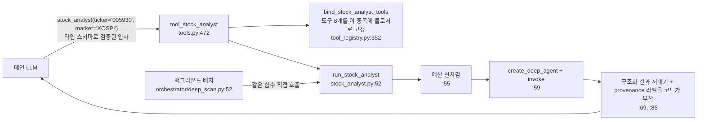
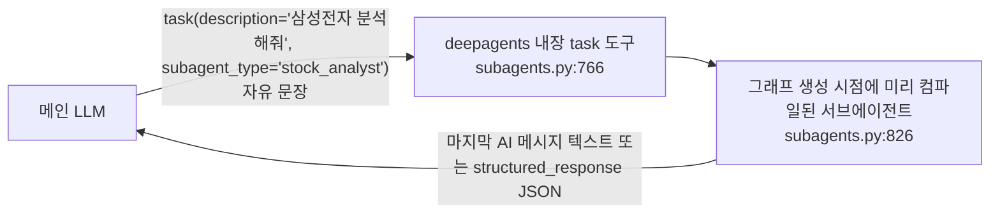

# 서브에이전트 연결 방식: 왜 `create_deep_agent(subagents=...)`가 아니라 "도구 안에서 `create_deep_agent`"인가

> 작성 2026-10-21. 상태: **설명 문서(코드 변경 없음)**.
> 근거: 설치된 `deepagents 0.7.13` 소스(`.venv/.../deepagents/middleware/subagents.py`, `graph.py`)와 이 저장소 코드를 직접 읽어 확인했다. 줄 번호는 이 날짜·버전 기준.
> 관련: `main-agent-migration-plan.md` §7(agent-as-tool 결정, 474~476행), `_review_parts/06_chat_agent.md`.

---

## 0. 한 줄 결론

`subagents=`로 바꾸는 건 **기술적으로 가능**하다. 하지만 지금 있는 서브에이전트들은 전부 "**정해진 종목 하나를, 정해진 절차 안에서, 코드가 앞뒤를 감싸서**" 돌리는 일이라, `subagents=`가 제공하는 방식(메인 LLM이 자유 문장으로 `task`를 호출)과 맞지 않는다. 바꾸면 얻는 것(진행 상황 스트리밍, 약간의 코드 감소)보다 잃는 것(종목 고정, 배치 재사용, 예산 선차감, 코드가 붙이는 출처 라벨, 실패 격리)이 크다.

단, "쓰면 **안 된다**"가 아니라 "**이 다섯 개에는 맞지 않는다**"다. 자유 조사형 서브에이전트가 생기면 그건 `subagents=`가 맞다(§7).

---

## 1. 두 방식이 실제로 하는 일

### 1.1 지금 방식 — agent-as-tool


### 1.2 `subagents=` 방식


핵심 차이는 세 가지다.
1. **인자**: `task`는 `description: str`, `subagent_type: str` 두 개뿐이다(`subagents.py:413-423`, `:766-770`). 종목·시장 같은 타입 인자를 받을 칸이 없다.
2. **도구 바인딩 시점**: 서브에이전트 그래프는 메인 그래프를 만들 때 **한 번** 컴파일된다(`subagents.py:826-830`). 어떤 종목이 들어올지 모르는 시점이다.
3. **호출 주체**: `task`는 메인 그래프 안에서, 메인 LLM이 호출할 때만 실행된다.

---

## 2. `subagents=`가 맞지 않는 이유 (중요도 순)

### 이유 1 — 종목·시장을 구조적으로 고정할 수 없다 (확신도 HIGH)

**지금**: 메인 LLM은 `stock_analyst(ticker, market)`를 부른다. `market`은 `AtomicMarket` enum(KOSPI/KOSDAQ/NASDAQ/NYSE)이라 스키마 검증을 통과해야 실행된다. 그다음 서브에이전트가 쓰는 도구 8개는 **인자가 없는 도구**로 만들어진다 — 종목과 시장이 클로저에 박혀 있다(`tool_registry.py:364-375`):
```python
def _bound_tool() -> dict:
    with binding_lock:
        return getattr(_tools, fn_name)(context, ticker, market)
```
그래서 서브에이전트가 판단할 수 있는 것은 "어떤 신호를 볼까"뿐이다. **다른 종목을 분석할 방법 자체가 없다.**

**`subagents=`라면**:
- 메인 LLM이 "삼성전자 분석해줘" 또는 "005930 KOSPI 분석"처럼 **문장으로** 써서 넘긴다.
- 서브에이전트 도구는 그래프 생성 시점(§1.2-2)에 정해지므로 종목을 미리 묶을 수 없다 → 도구가 `ticker`, `market`을 **인자로 받아야** 한다.
- 결과: 서브에이전트 LLM이 문장에서 티커·시장을 다시 뽑아 도구마다 넣는다. "삼성전자우(005935)"와 혼동, 동명이인, NASDAQ/NYSE 오인 같은 실수가 **두 번째 LLM 단계에서 다시** 생길 수 있다. 이 프로젝트가 지금까지 지켜 온 원칙("티커·날짜·시장은 코드가 정한다 — 환각 차단")을 서브에이전트 안에서 포기하게 된다.

우회책도 있긴 하다. 부모 state에 티커를 넣어 서브에이전트 미들웨어가 읽게 한다(`task`는 부모 state 일부를 서브에이전트로 넘긴다, `subagents.py:762`). 하지만 그러려면 "종목을 state에 쓰는 별도 도구 → `task` 호출" 2단계를 메인 LLM이 순서대로 지켜야 하고, 커스텀 state 키와 미들웨어가 추가된다. 지금보다 복잡하면서 보장은 약하다.

### 이유 2 — 메인 에이전트가 없는 곳에서도 같은 서브에이전트를 쓴다 (HIGH)

| 서브에이전트 | 메인 대화 밖 호출처 |
|---|---|
| `stock_analyst` | 백그라운드 추천 배치 — `orchestrator/deep_scan.py:52`가 숏리스트 종목마다 `run_stock_analyst(...)`를 **ThreadPoolExecutor로 병렬** 호출 |
| `recommendation_synthesis` | `orchestrator/recommendation_coordinator.py:182` — 메인 에이전트와 완전히 무관 |

`subagents=`로 등록한 서브에이전트는 메인 그래프의 `task` 도구로만 접근할 수 있다. 배치에서 쓰려면 지금 같은 `run_stock_analyst` 함수를 **어차피 따로 유지해야** 하고, 그러면 같은 서브에이전트가 두 경로로 정의되어 프롬프트·도구·예산 규칙이 어긋나기 시작한다(지금은 한 함수, 한 정의).

### 이유 3 — 서브에이전트 앞뒤를 코드가 감싸야 한다 (HIGH)

지금 각 `run_*` 함수는 LLM 앞뒤에 **결정론 코드**를 둔다.

| 단계 | 하는 일 | 위치 | `subagents=`에서 |
|---|---|---|---|
| 앞 | 이름 해석: 티커 → 회사명. 실패하면 서브에이전트를 띄우지도 않고 "이름 해석 실패"로 정확히 보고 | `tools.py:446-459` | 서브에이전트가 직접 해야 함(LLM) 또는 별도 도구 선행 필요 |
| 앞 | 턴 LLM 예산 선차감. 부족하면 LLM 호출 0회로 즉시 `available=false` | `stock_analyst.py:55`, `related_companies.py:87`, `etf_composition.py:69` | `task`에는 사전 훅이 없음 → 미들웨어를 새로 짜야 함 |
| 앞 | ETF: 구성종목별 공시·뉴스 신호를 **일반 코드로** 먼저 모으고, 남은 예산으로 분석 종목 수를 정한 뒤 "종합"만 LLM에 맡김 | `tools.py:585-622`, `etf-composition-analysis.md` 50행 | 메인 LLM이 언제 `task`를 부를지 모르므로 사전 수집 단계를 끼울 자리가 없음 |
| 앞 | 섹터: 공식 업종 매칭이 **실패했을 때만** 서브에이전트로 2차 탐색 | `sector_resolution.py:145` | 이건 메인 LLM의 위임 판단이 아니라 도구 내부 분기 — `task`로 표현할 이유가 없음 |
| 뒤 | 출처 라벨 `"서브에이전트 자율 조사 결과"`를 **LLM 출력이 아니라 코드가** 붙임 | `stock_analyst.py:85` | `task`는 서브에이전트 결과를 그대로 ToolMessage로 돌려줌(`subagents.py:689-715`) → 라벨을 붙일 자리가 없음 |
| 전체 | "절대 raise 안 함": 모든 실패를 `{"available": false, "error": ...}`로 바꿈 | `stock_analyst.py:58-80` | `task`는 `subagent.invoke(...)`를 try 없이 호출(`subagents.py:793`) — 실패가 부모 도구 노드로 그대로 전파. 부모가 어떻게 처리할지는 ToolNode 오류 설정에 달림(미확인) |

특히 마지막 두 줄이 중요하다. 메인 에이전트의 답변 정책(출처 라벨 명시, 실패 시 "데이터 없음" 고지)은 도구 결과가 **항상 같은 모양의 dict**로 온다는 전제 위에 있다. `task`는 문자열(또는 JSON 문자열)을 돌려주고, 실패하면 예외가 난다.

### 이유 4 — 예산과 노출 통제가 다시 설계돼야 한다 (MEDIUM~HIGH)

- **호출 상한 합산 안 됨**: 서브에이전트는 별도 그래프라 부모의 `ModelCallLimitMiddleware` 집계에 들어가지 않는다(`main-agent-migration-plan.md:475`, 당시 HIGH로 기록). 지금은 `QueryBudget` 선차감(이유 3)으로 턴 전체 예산을 묶고 있다. `subagents=`로 가면 서브에이전트마다 자체 상한 미들웨어 + 선차감 미들웨어를 새로 달아야 한다.
- **general-purpose 서브에이전트 자동 추가**: `subagents=`를 쓰면 deepagents는 `general-purpose` 서브에이전트를 기본으로 함께 넣는다(`graph.py:790-796`). 이 GP는 사용자 미들웨어 중 **기본 슬롯과 이름이 같은 것만** 상속한다(`graph.py:822`) → 우리 `ModelCallLimitMiddleware`, `ToolCallGuard` 등이 적용되지 않는 에이전트가 하나 생긴다. 끄는 방법을 따로 확인·적용해야 한다.
- **노출 통제**: 지금 메인은 `ExposureGuard`로 "레지스트리 도구 16개만 정확히 보이고, `task`·파일시스템 도구는 숨김"을 fail-closed로 강제한다(`agent_middleware.py:4-5, 60`). `subagents=`를 쓰려면 `task`를 열어야 하고, 이 보장 규칙과 그걸 고정한 골든 테스트(`tests/chat_agent/fixtures/`)를 다시 짜야 한다.

### 이유 5 — 평가·관찰 경로가 바뀐다 (MEDIUM)

- 지금 메인 루프는 `tool_done` 이벤트로 `stock_analyst`의 **구조화된 dict 결과**를 낸다. eval 스크립트와 새 평가 계획(`llm-answer-evaluation-plan.md` §4.3, §5.4)이 이걸 그대로 캡처한다.
- `task`는 `structured_response`를 JSON 문자열로 바꿔 ToolMessage에 넣는다(`subagents.py:689-696`). 결과를 다시 파싱해야 하고, 어떤 서브에이전트 결과인지 표시(LLM 생성 문맥 분리 집계)도 `subagent_type` 문자열에 의존하게 된다.

---

## 3. 이유가 **아닌** 것 (공정하게)

| 흔히 드는 이유 | 실제 |
|---|---|
| "`subagents=`는 구조화 출력이 안 된다" | **틀림.** `SubAgent`에 `response_format`이 있고(`subagents.py:163`), 결과는 JSON으로 부모에 전달된다(`:689-696`). |
| "`subagents=`는 서브에이전트별 도구·모델·미들웨어를 못 준다" | **틀림.** `tools`, `model`, `middleware` 모두 지정 가능(`subagents.py:131, 137, 143`). |
| "컨텍스트 격리가 안 된다" | **틀림.** 두 방식 모두 서브에이전트가 자기 메시지 목록에서 돌고 결과만 돌려준다(`subagents.py:762-763` — 부모 messages 대신 description 하나로 시작). |

즉 `subagents=` 자체가 나쁜 기능이라서가 아니다. **이 프로젝트의 서브에이전트들이 요구하는 것(타입 인자, 호출 시점 바인딩, 코드 래핑, 메인 밖 재사용)을 제공하지 않아서**다.

---

## 4. 지금 방식의 약점 (인정)

| 약점 | 영향 | 대응 |
|---|---|---|
| 매 호출마다 `create_deep_agent`로 그래프를 새로 만듦 | 컴파일 비용. 다만 서브에이전트 1회 = LLM 여러 번이라 상대적으로 작음(미측정) | 필요하면 모델·프롬프트가 같은 그래프를 캐시하고 도구만 바꾸는 구조로 개선 가능 |
| 서브에이전트 진행 상황이 UI에 안 보임 | 사용자는 "분석 중"만 봄 | 서브에이전트 invoke에 `on_event` 콜백을 넘겨 내부 tool 이벤트를 중계하면 해결 가능(별도 작업) |
| `run_*` 4개가 비슷한 보일러플레이트(선차감 → 생성 → invoke → 후처리 → 예외 변환) | 중복 | 공통 헬퍼 하나로 묶을 수 있음 — `subagents=`로 옮길 이유는 아님 |
| 메인 에이전트가 `create_deep_agent`를 쓰는 이득 자체가 현재 작음 | 내장 기능을 다 꺼서 사실상 `create_agent`와 같음(`main-agent-migration-plan.md:255`) | "나중에 `subagents=`·todo로 확장할 길을 열어 둔다"는 사용자 결정. §7의 경우가 생기면 그때 씀 |

---

## 5. 바꾸면 무엇이 달라지나 — 비용 표

| 항목 | 지금(agent-as-tool) | `subagents=`로 전환 시 |
|---|---|---|
| 종목·시장 고정 | 스키마 + 클로저로 구조적 보장 | 서브에이전트 LLM이 문장에서 다시 추출 |
| 배치 재사용(`deep_scan`, 추천 코디네이터) | 같은 함수 직접 호출 | 별도 함수 유지 필요(정의 이중화) |
| 예산 선차감 | 함수 첫 줄 | 커스텀 미들웨어 신규 |
| 사전 수집(ETF), 조건부 실행(섹터 2차) | 도구 내부 일반 코드 | 표현할 자리 없음 → 결국 도구로 남겨야 함 |
| 출처 라벨 | 코드가 결정론 부착 | 붙일 자리 없음(또는 후처리 미들웨어 신규) |
| 실패 격리 | 항상 `available=false` dict | 예외 전파(부모 처리 의존) |
| 노출 통제·골든 테스트 | 16개 고정, fail-closed | `task` 개방 + GP 비활성 + 테스트 재작성 |
| 진행 상황 스트리밍 | 없음 | 하위 그래프 이벤트로 가능 |
| 코드량 | `run_*` 보일러플레이트 | 일부 감소, 대신 미들웨어 증가 |

예상 작업량(대략): 서브에이전트 재배선 + 미들웨어 2~3개 신규 + 배치 경로 이중화 + 노출 가드·골든 테스트 재작성 + 메인 eval 재통과. **기능상 새로 얻는 것은 스트리밍 하나**다.

---

## 6. 서브에이전트별 판정

| 서브에이전트 | 누가 호출을 결정하나 | 입력 | `subagents=` 적합? | 이유 |
|---|---|---|---|---|
| `stock_analyst` | 메인 LLM + **배치 코드** | 종목 1개(타입) | ✗ | 이유 1·2·3 전부 |
| `find_related_companies` | 메인 LLM | 종목 1개 → 코드가 회사명 해석 후 전달 | ✗ | 이유 1·3(이름 해석 선행, 실패 귀속) |
| `etf_composition` | **도구 내부 코드**(신호 수집 후) | 이미 모은 구성종목 신호 | ✗ | LLM의 위임 판단이 아님. 사전 수집 단계 필요(이유 3) |
| 섹터 2차 탐색(`sector_resolution`) | **도구 내부 코드**(1차 실패 시만) | 섹터 질의 문자열 | ✗ | 조건부 폴백 — 메인 LLM이 고를 일이 아님 |
| `recommendation_synthesis` | **배치 코디네이터** | 숏리스트 | ✗(해당 없음) | 메인 에이전트와 무관 |

다섯 중 셋은 애초에 "메인 LLM이 위임할지 판단하는" 서브에이전트가 아니다. 도구나 배치 안의 **한 단계**다. `subagents=`는 "메인 LLM이 위임 여부와 내용을 판단한다"는 모델이라 이 셋에는 개념부터 맞지 않는다.

---

## 7. 그럼 `subagents=`는 언제 쓰나

다음 조건을 **모두** 만족하는 새 서브에이전트라면 `subagents=`가 맞다.
1. 입력이 타입 인자가 아니라 **자유 지시문**이다(예: "최근 2주 반도체 업황 이슈를 조사해서 요약해").
2. 메인 LLM이 **위임할지, 무엇을 맡길지** 판단하는 게 자연스럽다.
3. 앞뒤 결정론 처리(이름 해석, 사전 수집, 코드 라벨)가 필요 없다.
4. 메인 대화 밖(배치)에서 재사용하지 않는다.

그때 할 일(이미 `main-agent-migration-plan.md` §7에 기록된 방향과 같음):
- 그 서브에이전트에 자체 `ModelCallLimitMiddleware`와 예산 선차감 미들웨어를 단다.
- general-purpose 서브에이전트는 계속 끈다.
- `ExposureGuard` 허용 목록에 `task`를 추가하고 골든 테스트를 갱신한다.
- 기존 서브에이전트들은 agent-as-tool로 **그대로 둔다** — 두 방식은 공존할 수 있다.

---

## 8. 이 판단을 다시 볼 조건

- deepagents가 `task`에 **타입 인자(구조화 입력 스키마)**를 지원하게 되면 → 이유 1이 사라진다. 이유 2·3은 남는다.
- 백그라운드 배치가 `stock_analyst`를 더 이상 쓰지 않게 되면 → 이유 2가 사라진다.
- 서브에이전트 진행 상황 스트리밍이 사용자 요구로 중요해지면 → 먼저 §4의 콜백 중계로 해결해 보고, 그래도 부족하면 재검토.

---

## 9. 확인 근거

| 사실 | 출처 | 확신도 |
|---|---|---|
| `task`의 입력은 `description: str`, `subagent_type: str` | `deepagents/middleware/subagents.py:413-423`, `:766-770` (0.7.13) | HIGH |
| 서브에이전트 그래프는 미들웨어 생성 시 한 번 컴파일 | `subagents.py:826-830` | HIGH |
| 서브에이전트는 부모 messages 대신 description 하나로 시작, 부모 state 일부 상속 | `subagents.py:762-763` | HIGH |
| `task`는 invoke를 try 없이 호출 | `subagents.py:793` | HIGH |
| 결과는 `structured_response` JSON 또는 마지막 AI 텍스트로 ToolMessage | `subagents.py:689-715` | HIGH |
| `SubAgent`는 `tools`/`model`/`middleware`/`response_format` 지원 | `subagents.py:131, 137, 143, 163` | HIGH |
| `subagents=` 사용 시 general-purpose 자동 추가, 미들웨어는 기본 슬롯 이름만 상속 | `deepagents/graph.py:790-796`, `:822` | HIGH |
| 서브에이전트 호출이 부모 `ModelCallLimitMiddleware`에 합산되지 않음 | `main-agent-migration-plan.md:475`(당시 기록) | MEDIUM(이번에 재검증 안 함) |
| 종목 클로저 바인딩, 바인딩 내 Lock 직렬화 | `chat_agent/tool_registry.py:352-375` | HIGH |
| 배치에서 `run_stock_analyst` 직접 호출 | `orchestrator/deep_scan.py:22, 52` | HIGH |
| 예산 선차감·코드 라벨·예외 격리 | `chat_agent/stock_analyst.py:55-86`, `related_companies.py:84-91`, `etf_composition.py:60-72` | HIGH |
| ETF 사전 수집 후 종합, 섹터 2차 탐색은 1차 실패 시만 | `chat_agent/tools.py:585-622`, `sector_resolution.py:138-145` | HIGH |
| 메인에서 `task`·내장 도구 숨김(fail-closed) | `chat_agent/agent_middleware.py:4-5, 60` | HIGH |
